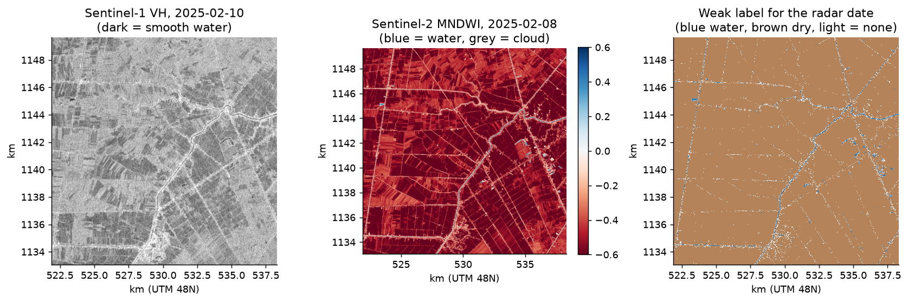
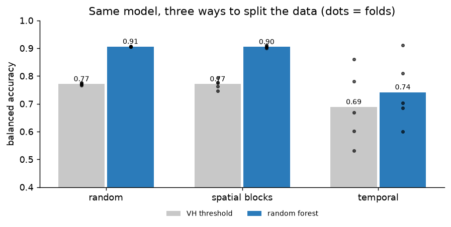
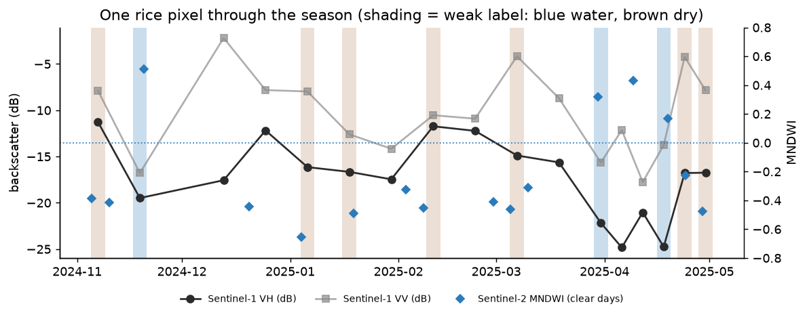
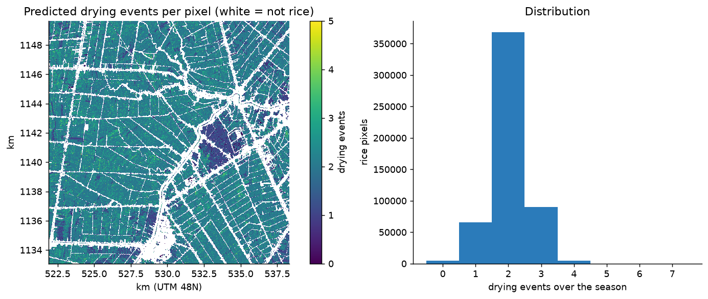

# Rice paddy flooding & AWD detection from Sentinel-1

Detect, for every rice pixel and every Sentinel-1 acquisition, whether a paddy is **flooded or drained**, and derive a field-level proxy for **Alternate Wetting and Drying (AWD)**. AWD is the water-management practice that cuts rice methane emissions by about 50%.

Study area: Thoai Son district, An Giang province, Mekong Delta (Vietnam), November 2024 to April 2025.



## Results

11 of 17 Sentinel-1 dates received weak labels from Sentinel-2 (3.7 M labelled pixel-dates, 12% water). 300,000 samples were drawn for training, over 169 spatial blocks of 1.28 km.

**Balanced accuracy (mean over folds)**



| Model | Random CV | Spatial-block CV | Temporal CV |
|---|---|---|---|
| VH threshold | 0.77 | 0.77 | 0.69 |
| Random forest | **0.91** | **0.91** | **0.74** (folds 0.60–0.91) |

- **Temporal context helps.** The random forest, which sees the previous and next acquisitions, beats a single VH threshold by 14 points.
- **The model transfers to new places, but not to new moments of the season.** Spatial and random scores are identical, while training on earlier dates and testing on later ones costs about 16 points. The crop changes the radar signature of water. A dense canopy scatters the signal back (and can cause double bounce between water and stems), so flooded fields stop looking dark. Optical labels are also less reliable under a dense canopy.
- Temporal folds are uneven (some have few labelled dates or little water), so the temporal mean is noisy. The per-fold range matters more than the mean.



### Why the way you split the data matters

A pixel is a 20 m × 20 m cell. A rice field of 100–300 m covers 25 to 200 pixels with nearly identical backscatter and the same water state. That creates two ways to fool yourself:

- **Random CV** shuffles pixel-dates. Pixels of the same field, on the same date, end up in both train and test, so the test set contains near-copies of training samples (spatial autocorrelation leakage).
- **Spatial-block CV** holds out whole 1.28 km squares. The model is tested on fields it has never seen.
- **Temporal CV** trains on earlier dates and tests on later ones. The model is tested on crop stages it has not seen. This matches the real use case: monitoring a season as it unfolds.

Here, random and spatial scores match because the model gets per-pixel values only (no coordinates, no image patches). The spatial spread across folds is still larger (std 0.004 vs 0.001), so a random split hides how much performance varies across the area. With patch-based CNNs or coordinate features, the random/spatial gap usually becomes large. **The temporal split exposes the real weakness.**

### From water status to AWD



Most rice pixels show 2–3 drying events between November and April. This window includes the final drainage and the re-flooding for the next crop, so it is not an AWD adoption map yet (see Known limitations).

## Why these choices

**Sentinel-1 (C-band SAR).**
- The Mekong is cloudy most of the year, and radar sees through clouds.
- Calm water reflects the radar pulse away (specular reflection), so flooded fields are very dark in VH/VV. A growing canopy brightens them.
- The data are free, at 10–20 m, every 6–12 days, analysis-ready (RTC) on Microsoft Planetary Computer.

Sentinel-2 (optical) is used only to create weak labels on clear days.

**Mekong Delta.**
- It is Vietnam's main rice basket, with two to three crops a year.
- It is the target of Vietnam's 1 million ha low-emission rice programme (2023-2030), which promotes AWD.
- The dry-season crop is chosen because irrigation is managed and Sentinel-2 sees more cloud-free scenes.

**Task.** The task is not rice vs non-rice mapping. It is **per-date water status on rice fields**, the observable that matters for methane MRV. The pipeline has three steps:
1. Build a rough rice mask (heuristic, `features.rice_mask_heuristic`).
2. Classify each pixel on each date as flooded or drained from Sentinel-1, trained on Sentinel-2 MNDWI weak labels (clear-sky pixels within 3 days).
3. Count flooded→drained transitions per pixel over the season (AWD proxy).

## Quickstart

```bash
conda env create -f environment.yml
conda activate ricepaddy
pip install -e .

pytest -q                                   # pipeline tests on synthetic data
python scripts/03_baseline.py --synthetic   # baseline end-to-end without any download

python scripts/01_download.py               # Sentinel-1 RTC + Sentinel-2 L2A -> data/*.zarr
python scripts/02_make_labels.py            # weak water labels on Sentinel-1 dates
python scripts/03_baseline.py               # cross-validation results, prediction maps -> outputs/real/
python scripts/04_figures.py                # README figures -> docs/assets/

jupyter lab notebooks/00_data_tour.ipynb    # what Sentinel-1 and Sentinel-2 see
jupyter lab notebooks/01_explore.ipynb      # labels, histograms, cross-validation, AWD maps
```

**Chapter 2, both orbits.** Ascending and descending passes give about twice as many dates. Each relative orbit has its own viewing geometry, so it is standardised to the reference orbit (`sentinel1.normalize: per_orbit`), and the orbit is given to the model as a feature:

```bash
python scripts/01_download.py --config config_ch2.yaml --only s1
python scripts/02_make_labels.py --config config_ch2.yaml
python scripts/03_baseline.py --config config_ch2.yaml     # -> outputs/both_orbits/
python scripts/04_figures.py --config config_ch2.yaml      # -> docs/assets/both_orbits/
```

No account is needed, because Planetary Computer signs data URLs anonymously. Edit `config.yaml` to change the area, period or thresholds.

## Layout

```
config.yaml                 area, period, label thresholds, cross-validation settings
src/ricepaddy/
  data.py                   STAC search + loading (odc-stac) of S1 RTC and S2 L2A, per-date checks
  labels.py                 MNDWI weak labels, S1/S2 date matching
  features.py               backscatter features with temporal context, rice mask, flattening
  crossval.py               random / spatial-block / temporal splits
  baseline.py               VH threshold and random forest, evaluation
  awd.py                    drying events, flooded fraction
  synthetic.py              synthetic cubes for tests
scripts/01_download.py … 04_figures.py   (add --config config_ch2.yaml for both orbits)
notebooks/00_data_tour.ipynb, 01_explore.ipynb
docs/assets/                figures used in this README
tests/
```

## Known limitations

- **Weak labels.** MNDWI misses water under a dense canopy, so late-season "dry" labels are noisy. The 3-day matching window lets the water state change between the two images.
- **Revisit vs process.** An AWD dry phase lasts about 5–10 days, while Sentinel-1 (one orbit) revisits every 6–12 days, so some dry phases fall between two images.
- **No AWD ground truth.** The drying-event count is a proxy. Over November–April it also counts final drainage and the re-flooding for the next crop.
- The rice mask is a heuristic, not ground truth.

## Next steps

- **Sequence model (PyTorch).** A 1D CNN or GRU reads the full per-pixel season, so it knows the crop stage. It is pre-trained self-supervised on unlabelled pixels (masked time-step reconstruction), fine-tuned on the weak labels, and evaluated with temporal and spatial splits.
- **Both Sentinel-1 orbits** (ascending + descending) to roughly halve the revisit, with incidence-angle normalisation.
- **Fusion with NISAR L-band SAR.** NISAR (NASA-ISRO, launched 2025, free data, 12-day repeat) uses a ~24 cm wavelength that penetrates the rice canopy and sees water underneath, exactly where C-band fails. Public products start in June 2026 and validated ones in October 2026, so this needs a 2026 season.
- **Ground truth.** Validate drying-event counts against field water-level (IoT) sensors or farmer-reported practice.
- Field boundaries (segmentation) to aggregate per field. Test transfer to another rice region.
