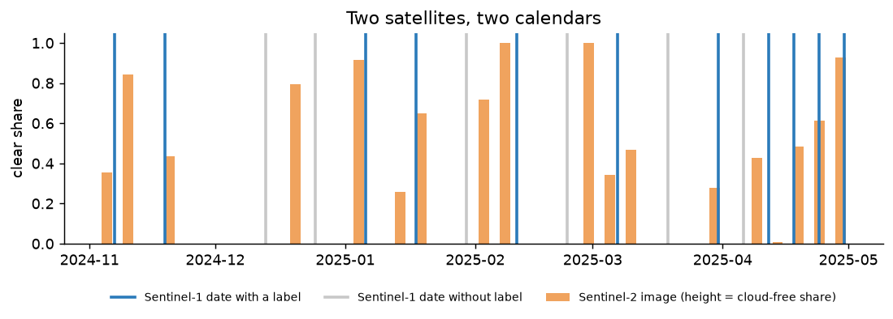
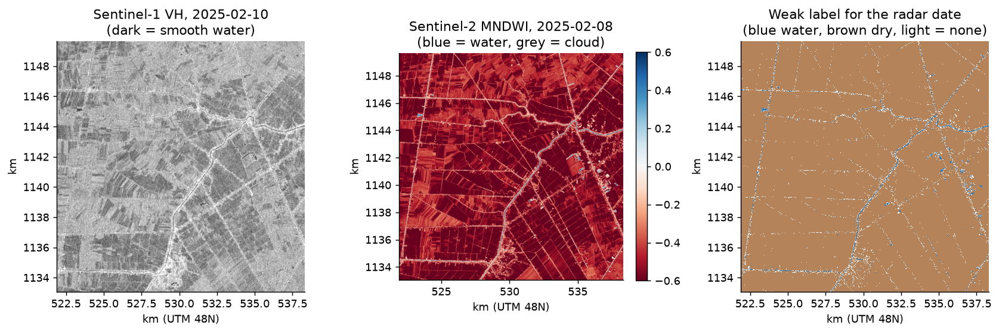
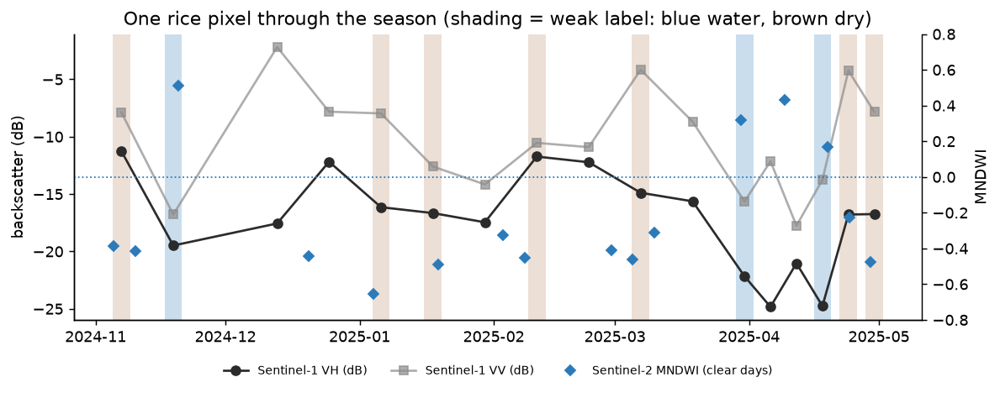
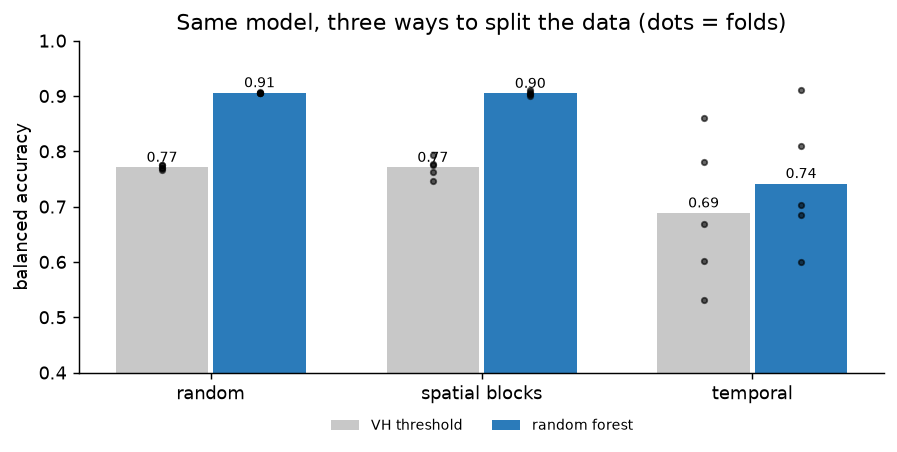
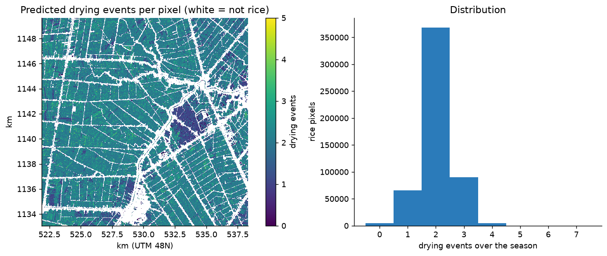

# Watching rice paddies from space: flooding, drainage and the trap of random cross-validation

*Antoine Nasser · November 2026 · [code on GitHub](https://github.com/antoine-182/sideproject_sentinel_ricepaddy)*

**In short.** I trained a model to tell, from free Sentinel-1 radar images, whether a rice field in the Mekong Delta is flooded or drained on each date, using clear-sky Sentinel-2 images as weak labels. A random forest reaches 0.91 balanced accuracy, whether the data are split at random or by geographic blocks. But when the model is trained on early dates and tested on later ones, accuracy drops to 0.74. The physics of the growing crop explains the drop, and that drop is the number that matters for monitoring a season in practice.

---

## Why look at rice fields?

Flooded rice paddies emit about 10% of human-caused methane. With no oxygen in the waterlogged soil, microbes turn organic matter into methane. **Alternate Wetting and Drying (AWD)** breaks the cycle: farmers let the water drop below the soil surface, then re-flood, several times per season. Meta-analyses report about 50% less methane for a yield loss of a few percent, plus water savings.

Farmers can be paid for adopting AWD, through carbon credits or supply-chain programmes. But someone has to **verify** that the fields were actually drained, across millions of small plots and without a field visit to each one. That is a measurement problem, and satellites are the only way to do it at that scale.

The question for this project is simple: **for each pixel and each satellite pass, is the field flooded or not?** Counting how many times a field goes from flooded to drained over a season then gives a proxy for AWD.

## Two satellites, two kinds of eyes

**Sentinel-1** is a radar. It sends microwaves and measures the energy that comes back (backscatter, in dB, in two polarisations: VV and VH). It works through clouds, day and night. Calm water acts like a mirror and sends the pulse away, so flooded fields look **very dark** (VH around −20 to −25 dB). A growing rice canopy scatters energy back and brightens the field.

**Sentinel-2** is an optical camera. Water stands out clearly through the MNDWI index, (green − SWIR) / (green + SWIR), which is positive over water. But it is blind under clouds, and the Mekong is cloudy for much of the year.

So I use the radar as the **input** of the model, because it is always available. I use the optical images only to make **labels**: a radar pixel gets the label "water" or "dry" if a cloud-free Sentinel-2 image of the same spot exists within 3 days.

*Sentinel-1 passes every 12 days, then every 6 days once Sentinel-1C joins in spring 2025. Sentinel-2 passes every 5 days but is often cloudy. 11 of the 17 radar dates get a label.*

*Same area seen by radar (left) and optical (middle), and the resulting weak label (right). Canals, villages and orchards show up as structure in both.*

**Study area:** a 16 × 16 km rice district in An Giang province (Mekong Delta, Vietnam), at 20 m resolution, from November 2024 to April 2025. This covers the dry-season (Winter-Spring) crop and the start of the next one.

## What a rice field looks like to a radar

*One rice pixel. Backscatter drops when the field is flooded for sowing, then rises as the crop grows. Shading shows the optical labels on the dates where they exist.*

Two features of this signal drive everything that follows:

1. **Flooding is a drop relative to the neighbouring dates**, not just a low absolute value. A model that sees the previous and next images has a big advantage.
2. **The same water gives a different signal as the crop grows.** Early in the season, water is bare and dark. Under a dense canopy, the radar bounces between the water surface and the stems ("double bounce") and the field can look bright even though it is flooded. Optical labels have the same blind spot, since MNDWI cannot see water under leaves either.

## Models

Two baselines, deliberately simple:

- **VH threshold:** "water if VH < t", with t tuned on the training data.
- **Random forest** on seven per-pixel features: VV, VH, the VH − VV ratio, VH at the previous and next acquisitions, and the differences.

## How you split the data changes the answer

A Sentinel-1 pixel is a 20 × 20 m cell. A rice field of 100 to 300 m covers 25 to 200 pixels with nearly identical signal and the same water state. On a given date, these pixels are almost copies of each other.

I evaluated the same models with three ways of splitting 300,000 labelled pixel-dates into training and test sets (5 folds each):

- **Random:** pixel-dates are shuffled. Pixels of the same field on the same date land on both sides, so the model is partly tested on what it has already seen.
- **Spatial blocks:** whole 1.28 km squares are held out. The model is tested on fields it has never seen.
- **Temporal:** the model is trained on earlier dates and tested on later ones. This is the realistic setting, monitoring a season as it unfolds.

| Model | Random | Spatial blocks | Temporal |
|---|---|---|---|
| VH threshold | 0.77 | 0.77 | 0.69 |
| Random forest | 0.91 | 0.91 | 0.74 (folds: 0.60 – 0.91) |

*Balanced accuracy, mean over folds.*

Three findings:

- **Temporal context pays off.** The random forest beats the threshold by 14 points, mostly thanks to the previous and next images.
- **No spatial leakage here, and that is expected.** The model sees per-pixel values only, with no coordinates and no image patches, so it cannot memorise places. The spatial folds still vary more than the random ones (std 0.004 vs 0.001), and a random split hides that variation. With patch-based CNNs or coordinate features, the random score would typically climb well above the spatial one.
- **The real gap is in time.** Training on early dates and testing on later ones costs 16 points. The model has learnt what water looks like at one crop stage and meets another. The temporal folds are uneven (some test periods have few labelled dates or little water), so the range across folds tells more than the mean.

The lesson: **a random split would have told me the problem was solved.** The split has to match how the model will be used, and for crop monitoring that means testing on unseen dates and unseen places.

## From water status to AWD

The model predicts flooded (1) or drained (0) for every pixel and date, for example `0111011100`. Each 1 → 0 transition is a drying event. Continuous flooding gives about one event per crop (the final drainage before harvest), while AWD gives two or more.

*Predicted number of drying events per rice pixel, November 2024 – April 2025. Canals and villages are masked out.*

The field structure comes out clearly, and most rice pixels show two to three drying events. I would not read this as an AWD adoption map yet, for three reasons:

- The window covers the end of one crop and the re-flooding for the next, so the count mixes final drainage, inter-crop drainage and possible mid-season drying.
- An AWD dry phase lasts about 5–10 days, and Sentinel-1 passes every 6–12 days, so short dry phases can fall between two images.
- There is no field-level ground truth to check against.

## What I would do next

- **A sequence model in PyTorch** (1D CNN or GRU) that reads a pixel's full season, so it knows the crop stage. Pre-train it self-supervised on the millions of unlabelled pixels (mask some dates and reconstruct them), fine-tune it on the weak labels, and judge it on the temporal split.
- **Both Sentinel-1 orbits**, ascending and descending, to roughly halve the time between images.
- **NISAR L-band radar.** The NASA-ISRO mission launched in 2025 uses a ~24 cm wavelength that goes through the rice canopy and sees the water underneath, exactly where Sentinel-1's C-band (~5.6 cm) struggles. Its data are free, with validated products since October 2026. Fusing it with Sentinel-1 on a 2026 season is the natural next step.
- **Ground truth** from field water-level sensors or farmer records, to turn the drying-event proxy into a validated AWD indicator.

## Reproduce

Everything runs on a laptop with free data from Microsoft Planetary Computer, with no account needed. See the [README](https://github.com/antoine-182/sideproject_sentinel_ricepaddy#quickstart): four scripts (download, labels, baseline, figures) and two notebooks.

*Data: Copernicus Sentinel-1 and Sentinel-2 (ESA), accessed through Microsoft Planetary Computer.*
